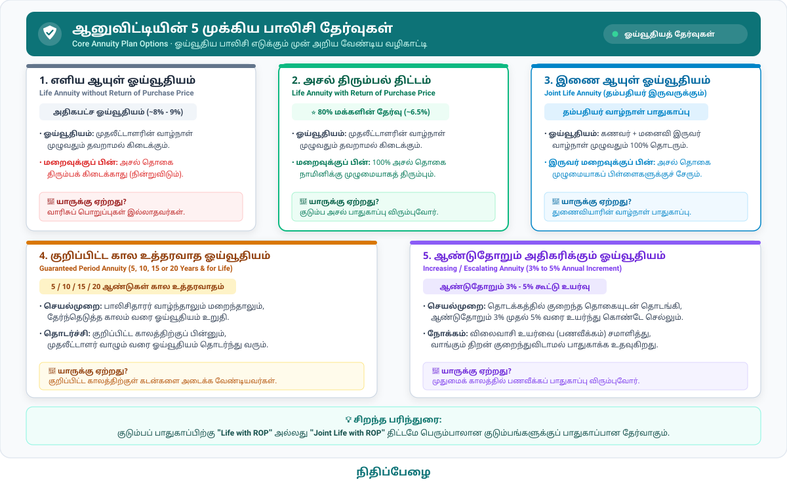
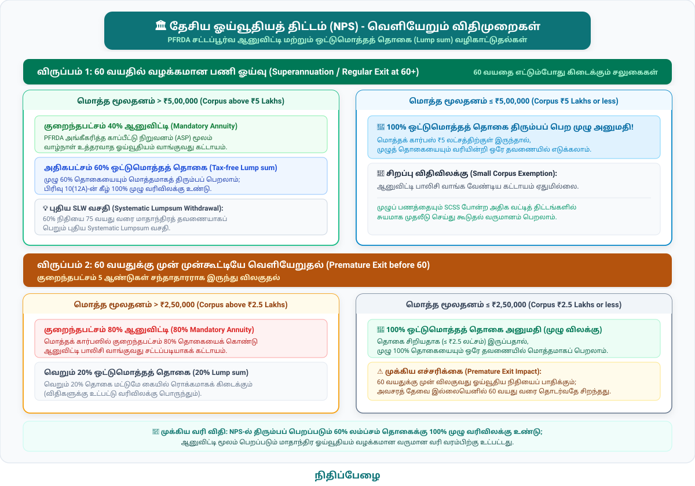
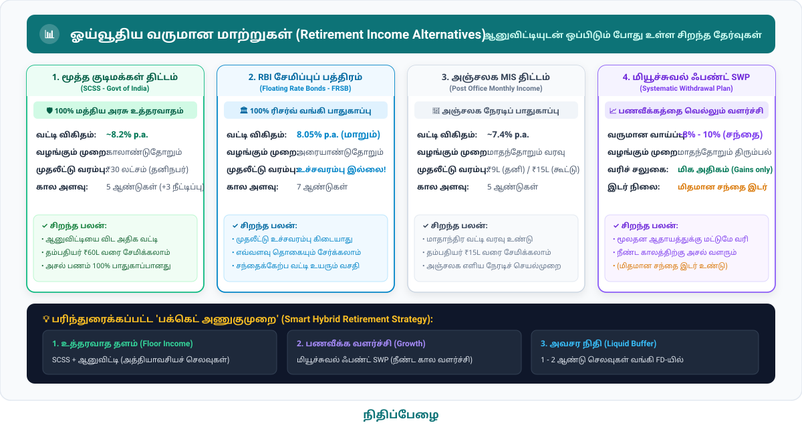

பணி ஓய்வுக் காலத்தை (Retirement) திட்டமிடும் ஒவ்வொருவருக்கும் எழும் முக்கியமான அச்சம்: **"நான் சேமித்து வைத்துள்ள ஓய்வூதிய நிதி, எனது வாழ்நாள் முழுவதும் போதுமானதாக இருக்குமா அல்லது எனக்கு முன்பே தீர்ந்துவிடுமா?"** என்பதுதான். 

அரசு ஊழியர்களுக்கு முன்பு இருந்த பழைய ஓய்வூதியத் திட்டம் (Old Pension Scheme - OPS) போல உத்தரவாதமான மாதாந்திர வருமானம் இல்லாத தனியார் துறை ஊழியர்கள், தகவல் தொழில்நுட்பப் பணியாளர்கள் மற்றும் சுயதொழில் செய்வோருக்கு இந்த வாழ்நாள் நிதிப் பாதுகாப்பை உறுதி செய்ய உருவாக்கப்பட்ட மிக முக்கியமான நிதிப் பாதுகாப்பு ஏற்பாடே **ஆனுவிட்டி (Annuity)** அல்லது **தவணை ஓய்வூதியம்** ஆகும்.

மேலும், மத்திய அரசின் **தேசிய ஓய்வூதியத் திட்டத்தில் (NPS)** இணையும் ஒவ்வொருவரும் தனது 60 வயதில் ஓய்வு பெறும்போது, தனது சேமிப்பில் குறிப்பிட்ட பகுதியை ஆனுவிட்டியாக மாற்றுவது சட்டப்பூர்வமாகக் கட்டாயமாக்கப்பட்டுள்ளது.

---

  

    ⚡ விரைவு வழிசெலுத்தல் (Quick Jump):
  

  

    <a href="#what-is-annuity" style="font-size: 13px; font-weight: 600; padding: 5px 12px; border-radius: 9999px; background: #e6f5f3; color: #0D7377; text-decoration: none; border: 1px solid #b2dfdb;">1. ஆனுவிட்டி விளக்கம்</a>
    <a href="#annuity-types" style="font-size: 13px; font-weight: 600; padding: 5px 12px; border-radius: 9999px; background: #e6f5f3; color: #0D7377; text-decoration: none; border: 1px solid #b2dfdb;">2. முக்கிய வகைகள் &amp; தேர்வுகள்</a>
    <a href="#when-to-use" style="font-size: 13px; font-weight: 600; padding: 5px 12px; border-radius: 9999px; background: #e6f5f3; color: #0D7377; text-decoration: none; border: 1px solid #b2dfdb;">3. எப்போது பயன்படுத்த வேண்டும்?</a>
    <a href="#who-is-it-for" style="font-size: 13px; font-weight: 600; padding: 5px 12px; border-radius: 9999px; background: #e6f5f3; color: #0D7377; text-decoration: none; border: 1px solid #b2dfdb;">4. யாருக்கு ஏற்றது?</a>
    <a href="#nps-mandate" style="font-size: 13px; font-weight: 600; padding: 5px 12px; border-radius: 9999px; background: #e6f5f3; color: #0D7377; text-decoration: none; border: 1px solid #b2dfdb;">5. NPS கட்டாய விதிகள்</a>
    <a href="#leading-providers" style="font-size: 13px; font-weight: 600; padding: 5px 12px; border-radius: 9999px; background: #e6f5f3; color: #0D7377; text-decoration: none; border: 1px solid #b2dfdb;">6. முன்னணி நிறுவனங்கள்</a>
    <a href="#alternatives" style="font-size: 13px; font-weight: 600; padding: 5px 12px; border-radius: 9999px; background: #e6f5f3; color: #0D7377; text-decoration: none; border: 1px solid #b2dfdb;">7. மாற்றுத் திட்டங்கள்</a>
    <a href="#comparison-table" style="font-size: 13px; font-weight: 600; padding: 5px 12px; border-radius: 9999px; background: #e6f5f3; color: #0D7377; text-decoration: none; border: 1px solid #b2dfdb;">8. ஒப்பீட்டு அட்டவணை</a>
    <a href="#taxation" style="font-size: 13px; font-weight: 600; padding: 5px 12px; border-radius: 9999px; background: #e6f5f3; color: #0D7377; text-decoration: none; border: 1px solid #b2dfdb;">9. வரிவிதிப்பு</a>
    <a href="#bucket-strategy" style="font-size: 13px; font-weight: 600; padding: 5px 12px; border-radius: 9999px; background: #e6f5f3; color: #0D7377; text-decoration: none; border: 1px solid #b2dfdb;">10. பக்கெட் உத்தி</a>
    <a href="#faqs" style="font-size: 13px; font-weight: 600; padding: 5px 12px; border-radius: 9999px; background: #e6f5f3; color: #0D7377; text-decoration: none; border: 1px solid #b2dfdb;">11. அடிக்கடி கேட்கப்படும் கேள்விகள்</a>
    <a href="#checklist" style="font-size: 13px; font-weight: 600; padding: 5px 12px; border-radius: 9999px; background: #e6f5f3; color: #0D7377; text-decoration: none; border: 1px solid #b2dfdb;">12. சரிபார்ப்புப் பட்டியல்</a>
  

---

<h2 id="what-is-annuity">1. ஆனுவிட்டி (Annuity) என்றால் என்ன?</h2>

**ஆனுவிட்டி (Annuity)** என்பது ஒரு தனிநபருக்கும், ஓர் ஆயுள் காப்பீட்டு நிறுவனத்திற்கும் (Life Insurance Company) இடையே ஏற்படுத்தப்படும் ஒரு சட்டப்பூர்வ நிதி ஒப்பந்தமாகும்.

இதன் கீழ், முதலீட்டாளர் ஒரு குறிப்பிட்ட பெரும் தொகையை (Purchase Price) காப்பீட்டு நிறுவனத்திடம் மொத்தமாகச் செலுத்துவார். அதற்கு ஈடாக, அந்நிறுவனம் முதலீட்டாளரின் வாழ்நாள் முழுவதும் (அல்லது ஒப்பந்தத்தில் ஒப்புக்கொள்ளப்பட்ட காலத்திற்கு) மாதம், காலாண்டு, அரையாண்டு அல்லது ஆண்டுதோறும் தவறாமல் நிலையான, உத்தரவாதமான ஓய்வூதியத்தை (Regular Guaranteed Pension) வழங்கும்.

> **வாழ்நாள் ஆபத்து மாற்றம் (Longevity Risk Transfer):**  
> ஒருவர் தான் எதிர்பார்த்த ஆயுளை விட அதிக காலம் (எ.கா: 85, 95 அல்லது 100 வயது வரை) வாழ நேரிடும் போது, அவரது சேமிப்புப் பணம் போதாமல் போகும் அபாயத்தை நிதி உலகில் "Longevity Risk" என்பார்கள். ஆனுவிட்டி இந்த ஆபத்தை முழுமையாகக் காப்பீட்டு நிறுவனத்தின் தோள்களுக்கு மாற்றிவிடுகிறது. நீங்கள் எத்தனை ஆண்டுகள் வாழ்ந்தாலும், பாலிசி ஒப்பந்தத்தின்படி இறுதி மூச்சு வரை ஓய்வூதியம் தொடர்ந்து உங்கள் வங்கிக் கணக்கில் வரவு வைக்கப்படும்.

### வங்கி வைப்பு நிதி (FD) vs ஆனுவிட்டி — என்ன வேறுபாடு?

| அம்சம் | வங்கி நிலையான வைப்பு நிதி (Bank FD) | ஆனுவிட்டி (Annuity) |
| :--- | :--- | :--- |
| **வட்டி / வருமான உத்தரவாதம்** | அதிகபட்சம் 5 முதல் 10 ஆண்டுகளுக்கு மட்டுமே வட்டி விகிதம் உறுதியானது. | அடுத்த 30, 40 அல்லது 50 ஆண்டுகள் ஆயுள் முழுமைக்கும் விகிதம் மாறாமல் நிலைத்திருக்கும். |
| **மறுமுதலீட்டு அபாயம் (Reinvestment Risk)** | உண்டு. FD முதிர்வடையும் போது நாட்டில் வட்டி விகிதம் குறைந்திருந்தால் (எ.கா: 7%-லிருந்து 4%-ஆக குறைந்தால்), குறைவான வட்டிக்குத்தான் புதுப்பிக்க முடியும். | இல்லை. பாலிசி எடுக்கும் நாளில் நிர்ணயிக்கப்பட்ட வருமான விகிதம் வாழ்நாள் முழுவதும் மாறாது. |
| **அசல் பணப்புழக்கம் (Liquidity)** | எப்போது வேண்டுமானாலும் அபராதக் கட்டணத்துடன் அசல் தொகையைத் திரும்ப எடுக்கலாம். | பொதுவாக அசல் தொகையை இடையில் திரும்ப எடுக்க முடியாது (சில குறிப்பிட்ட மருத்துவ அவசரக் காலங்களைத் தவிர). |
| **கால அளவு** | குறுகிய அல்லது நடுத்தர காலம் (1 முதல் 10 ஆண்டுகள்). | வாழ்நாள் முழுவதும் (Lifelong). |

  <a href="#quick-jump" style="font-size: 13px; font-weight: 600; color: #0D7377; text-decoration: none; display: inline-flex; align-items: center; gap: 4px; padding: 4px 10px; border-radius: 6px; background: #f0fdfa; border: 1px solid #ccfbf1;">
    ↑ மேலே செல்ல (Back to Top)
  </a>

---

<h2 id="annuity-types">2. ஆனுவிட்டியின் முக்கிய வகைகள் மற்றும் பாலிசி விருப்பங்கள்</h2>

இந்தியாவில் ஆயுள் காப்பீட்டு நிறுவனங்கள் ஆனுவிட்டியை இரண்டு முக்கியக் கால அடிப்படையில் வழங்குகின்றன:

1. **உடனடி ஓய்வூதியம் (Immediate Annuity):** மொத்த முதலீட்டுத் தொகையைச் செலுத்திய உடனேயே (அடுத்த மாதமே, அடுத்த காலாண்டிலோ அல்லது அடுத்த ஆண்டிலோ) ஓய்வூதியம் கிடைக்கத் தொடங்கும். 58 அல்லது 60 வயதில் பணி ஓய்வு பெறுபவர்களுக்கும், NPS கணக்கிலிருந்து முதிர்வுத் தொகையைப் பெறுபவர்களுக்கும் இதுவே நேரடித் தேர்வாகும். *(எ.கா: LIC Jeevan Akshay VII, SBI Life Annuity Plus)*
2. **தாமத / பிந்தைய ஓய்வூதியம் (Deferred Annuity):** இப்போதே மொத்தமாகவோ அல்லது குறிப்பிட்ட ஆண்டுகள் தவணையாகவோ செலுத்திவிட்டு, ஓய்வூதியத்தை உடனடியாகப் பெறாமல் எதிர்காலத்தில் ஒரு குறிப்பிட்ட வயதில் (எ.கா: 5 அல்லது 10 ஆண்டுகள் கழித்து, 55 அல்லது 60 வயதில்) பெறத் தொடங்கும் முறை. *(எ.கா: LIC Jeevan Shanti)*

ஆனுவிட்டி எடுக்கும் போது கீழ்க்காணும் ஐந்து விருப்பங்களில் ஒன்றை நீங்கள் தேர்வு செய்ய வேண்டும். ஒவ்வொன்றின் விரிவான விவரங்கள் கீழே கொடுக்கப்பட்டுள்ளன:

  1. எளிய ஆயுள் ஓய்வூதியம் (Life Annuity without Return of Purchase Price)
  அதிகபட்ச ஓய்வூதியம் (~8-9%)

* **எவ்வாறு செயல்படுகிறது:** முதலீட்டாளர் உயிருடன் இருக்கும் வரை மிக அதிகபட்ச மாதாந்திர ஓய்வூதியம் வழங்கப்படும் (உதாரணமாக ₹10 லட்சத்திற்கு ஆண்டுக்கு சுமார் ₹85,000 - ₹90,000 வரை கிடைக்கக்கூடும்).
* **மறைவுக்குப் பின்:** முதலீட்டாளர் மறைந்த அடுத்த மாதமே ஓய்வூதியம் நின்றுவிடும்; அவர் செலுத்திய அசல் முதலீடு (Purchase Price) வாரிசுகளுக்குத் திரும்பக் கிடைக்காது.
* **யாருக்கு ஏற்றது:** வாரிசுகள் இல்லாதவர்கள் அல்லது அடுத்த தலைமுறைக்குச் சொத்து விட்டுச்செல்ல வேண்டிய குடும்பப் பொறுப்பு இல்லாத, அதிகபட்ச மாத வருமானம் மட்டுமே தேவைப்படும் மூத்த குடிமக்கள்.

  2. அசல் திரும்பக் கிடைக்கும் ஆயுள் ஓய்வூதியம் (Life Annuity with Return of Purchase Price - ROP)
  80% மக்களின் தேர்வு (~6.5%)

* **எவ்வாறு செயல்படுகிறது:** முதலீட்டாளர் உயிருடன் வாழும் வரை மாதந்தோறும் ஓய்வூதியம் வழங்கப்படும். எளிய ஓய்வூதியத்தை விட இதன் விகிதம் 1% முதல் 2% வரை குறைவாக இருக்கும் (உதாரணமாக ₹10 லட்சத்திற்கு ஆண்டுக்கு சுமார் ₹63,000 - ₹68,000).
* **மறைவுக்குப் பின்:** முதலீட்டாளர் காலமான பிறகு, பாலிசிக்காக ஆரம்பத்தில் செலுத்திய அசல் தொகை 100% முழுமையாக அவரது நாமினிக்கு (குடும்பத்திற்கு) வரிவிலக்குடன் திருப்பித் தரப்படும்.
* **ஏன் பிரபலமானது:** குடும்பத்திற்கு அசல் தொகை பாதுகாப்பாகச் சென்று சேரும் என்ற நிம்மதியைத் தருவதால், இந்தியாவில் ஆனுவிட்டி வாங்குபவர்களில் 80%-க்கும் அதிகமானோர் தேர்ந்தெடுக்கும் முதன்மைத் திட்டம் இதுவே.

  3. இணை ஆயுள் ஓய்வூதியம் (Joint Life Annuity with Return of Purchase Price)
  தம்பதியர் பாதுகாப்பு

* **எவ்வாறு செயல்படுகிறது:** கணவன் மற்றும் மனைவி இருவருக்கும் பாதுகாப்பு தரும் திட்டம். முதலீட்டாளர் வாழும் வரை அவருக்கு முழு ஓய்வூதியம் கிடைக்கும். அவரது மறைவுக்குப் பின், அவரது துணைவியாருக்கு (Spouse) வாழ்நாள் முழுவதும் 100% ஓய்வூதியம் தொடர்ந்து கிடைக்கும்.
* **இருவர் மறைவுக்குப் பின்:** இருவருமே மறைந்த பிறகு, செலுத்திய அசல் தொகை முழுமையாக அடுத்த தலைமுறை வாரிசுகளுக்குத் (பிள்ளைகளுக்கு) திரும்ப வழங்கப்படும்.
* **யாருக்கு ஏற்றது:** தனது மறைவுக்குப் பிறகும் மனைவி அல்லது கணவரின் மாதாந்திர வாழ்வாதாரம் எவ்விதத் தடையுமின்றி தொடர வேண்டும் என விரும்பும் ஓய்வூதியதாரர்கள்.

  4. உறுதி செய்யப்பட்ட குறிப்பிட்ட கால ஓய்வூதியம் (Annuity Guaranteed for 5, 10, 15 or 20 Years)
  கால உத்தரவாதம்

* **எவ்வாறு செயல்படுகிறது:** முதலீட்டாளர் உயிரோடு இருந்தாலும் சரி, அல்லது இடைப்பட்ட காலத்தில் எதிர்பாராதவிதமாக மரணமடைந்தாலும் சரி, தேர்ந்தெடுக்கப்பட்ட காலம் (எ.கா: 15 ஆண்டுகள்) முடியும் வரை குடும்பத்திற்கு ஓய்வூதியம் உத்தரவாதமாக வந்து சேரும். 
* 15 ஆண்டுகளுக்குப் பிறகும் முதலீட்டாளர் உயிருடன் இருந்தால், அவரது வாழ்நாள் இறுதி வரை ஓய்வூதியம் தொடர்ந்து வழங்கப்படும்.
* **யாருக்கு ஏற்றது:** குறிப்பிட்ட காலத்திற்குள் பிள்ளைகளின் படிப்பு அல்லது குடும்பக் கடன்களை அடைக்க வேண்டிய கடமை உள்ளவர்கள்.

  5. ஆண்டுதோறும் அதிகரிக்கும் ஓய்வூதியம் (Increasing / Escalating Annuity)
  பணவீக்கத் தற்காப்பு

* **எவ்வாறு செயல்படுகிறது:** தொடக்க ஆண்டில் சற்று குறைவான ஓய்வூதியத்துடன் தொடங்கி, ஒவ்வொரு ஆண்டும் குறிப்பிட்ட சதவீதத்தில் (எ.கா: ஆண்டுக்கு 3% அல்லது 5% கூட்டு வட்டி விகிதத்தில்) ஓய்வூதியத் தொகை உயர்ந்து கொண்டே செல்லும்.
* **பயன்:** எதிர்காலப் பணவீக்கத்தை (விலைவாசி உயர்வை) ஓரளவு சமாளிக்க இது வடிவமைக்கப்பட்டுள்ளது. தொடக்க விகிதம் குறைவாக இருப்பது மட்டுமே இதில் உள்ள ஒரே சவால்.

  <a href="#quick-jump" style="font-size: 13px; font-weight: 600; color: #0D7377; text-decoration: none; display: inline-flex; align-items: center; gap: 4px; padding: 4px 10px; border-radius: 6px; background: #f0fdfa; border: 1px solid #ccfbf1;">
    ↑ மேலே செல்ல (Back to Top)
  </a>

---

<h2 id="when-to-use">3. ஆனுவிட்டியை எப்போது பயன்படுத்த வேண்டும்?</h2>

ஆனுவிட்டி என்பது செல்வத்தைப் பெருக்கும் (Wealth Creation) கருவி அல்ல; அது வாழ்வாதாரத்தைப் பாதுகாக்கும் (Income Protection) கருவி. எனவே இதை சரியான காலகட்டத்தில் மட்டுமே பயன்படுத்த வேண்டும்:

1. **பணி ஓய்வுக் காலத்தை எட்டும்போது (Age 55 - 60+):** மாதாந்திரச் சம்பளம் நிற்கும் போது, அன்றாடக் குடும்பச் செலவுகளுக்கு நிரந்தர வருமான ஓட்டத்தை (Cash Flow) உருவாக்க இது பயன்படுகிறது.
2. **அடிப்படை வாழ்வாதாரச் செலவுகளை (Floor Income) உறுதி செய்ய:** மாதாந்திர மளிகை, வீட்டு வாடகை, பராமரிப்புச் செலவு, மின்சாரம் மற்றும் அத்தியாவசிய மருந்துகள் போன்ற எக்காரணம் கொண்டும் தவிர்க்க முடியாத அடிப்படைச் செலவுகளுக்கான தொகையை மட்டும் ஆனுவிட்டி மூலம் பூர்த்தி செய்ய வேண்டும். பங்குச்சந்தை எவ்வளவு சரிந்தாலும் இந்த அடிப்படை வருமானம் பாதிக்கப்படாது.
3. **NPS கணக்கிலிருந்து முதிர்வுத் தொகையைப் பெறும் போது:** சட்டப்படியான விதிகளுக்கு உட்பட்டு ஓய்வூதிய நிதியில் ஒரு பகுதியை ஆனுவிட்டியாக மாற்றும்போது.
4. **முதுமைக்கால நிதிப் பராமரிப்புச் சுமையைத் தவிர்க்க விரும்பும் போது (Age 75+):** 75 அல்லது 80 வயதிற்கு மேல் பங்குச்சந்தை மாற்றங்கள், மியூச்சுவல் ஃபண்ட் போர்ட்ஃபோலியோ மறுசீரமைப்பு, FD முதிர்வு புதுப்பிப்புகள் போன்ற நிதி விவகாரங்களை நிர்வகிப்பது பல முதியவர்களுக்குச் சவாலானது. ஆனுவிட்டியில் முதலீடு செய்தால், வாழ்நாள் முழுவதும் மாதம் ஒரு குறிப்பிட்ட நாளில் தானாகவே பணம் வங்கிக் கணக்கிற்கு வந்துவிடும்.

  <a href="#quick-jump" style="font-size: 13px; font-weight: 600; color: #0D7377; text-decoration: none; display: inline-flex; align-items: center; gap: 4px; padding: 4px 10px; border-radius: 6px; background: #f0fdfa; border: 1px solid #ccfbf1;">
    ↑ மேலே செல்ல (Back to Top)
  </a>

---

<h2 id="who-is-it-for">4. ஆனுவிட்டி யாருக்கு ஏற்றது? யாருக்கு ஏற்றதல்ல?</h2>

  ✅ ஆனுவிட்டி யாருக்கு மிகவும் ஏற்றது? (Ideal For)
  பரிந்துரைக்கப்படுபவர்கள்

* **ஓய்வூதியம் இல்லாத தனியார் மற்றும் சுயதொழில் செய்வோர்:** அரசு ஊழியர்கள் அல்லாத, வாழ்நாள் முழுவதும் மாதந்தோறும் உத்தரவாத ஓய்வூதியம் தேவைப்படும் முதியவர்கள்.
* **பழமைவாத மூத்த குடிமக்கள் (Conservative Retirees):** பங்குச்சந்தை அல்லது மியூச்சுவல் ஃபண்டுகளின் ஏற்ற இறக்கங்களைப் பார்த்துப் பதற்றமடைபவர்கள்; முதலீட்டு அசல் குறையவே கூடாது என நினைப்பவர்கள்.
* **நீண்ட ஆயுள் கொண்ட குடும்பப் பின்னணி உள்ளவர்கள்:** குடும்பத்தில் 85, 90 வயது வரை வாழும் மரபணுப் பின்னணி கொண்டவர்களுக்கு, நீண்ட ஆயுள் அபாயத்தைத் தவிர்க்க ஆனுவிட்டி ஒரு சிறந்த வரப்பிரசாதம்.
* **நிதிச் சந்தை அறிவில்லாத துணைவியாரைக் கொண்ட குடும்பங்கள்:** தான் இல்லாத காலத்திலும் தனது வாழ்க்கைத்துணைக்கு யாருடைய தயவும் இன்றி மாதாந்திர வருமானம் கிடைக்க வழிசெய்ய விரும்புவோர்.

  ⚠️ ஆனுவிட்டி யாருக்கு ஏற்றதல்ல? (NOT Ideal For)
  கவனிக்க வேண்டியவர்கள்

* **இளம் வயதினர் (Below 50 years):** 30 அல்லது 40 வயதில் இருப்பவர்கள் தங்கள் முதலீட்டைப் பங்குச்சந்தை மற்றும் ஈக்விட்டி மியூச்சுவல் ஃபண்டுகளில் கூட்டு வளர்ச்சிக்கு (Compounding) உட்படுத்த வேண்டுமே தவிர, 6% தரும் ஆனுவிட்டியில் முடக்கக் கூடாது.
* **அவசர காலப் பணப்புழக்கம் தேவைப்படுபவர்கள் (Liquidity Seekers):** ஆனுவிட்டியில் செலுத்தப்படும் அசல் தொகை முழுமையாக முடக்கப்படும். அவசரத் தேவைக்காகப் பாலிசியை பாதியில் ரத்து செய்து பணத்தை மீட்பது மிகக் கடினம் அல்லது பெரும் நஷ்டத்தை ஏற்படுத்தும்.
* **பணவீக்கத்தை மட்டுமே வெல்லத் துடிப்பவர்கள்:** ஆனுவிட்டியின் வருமானம் நிலையானது (Fixed). நாட்டின் பணவீக்கம் ஆண்டுக்கு 6% உயர்ந்தால், 15 ஆண்டுகளுக்குப் பிறகு இந்த நிலையான ஓய்வூதியத்தின் வாங்கும் திறன் (Purchasing Power) பாதியாகக் குறைந்துவிடும்.

  <a href="#quick-jump" style="font-size: 13px; font-weight: 600; color: #0D7377; text-decoration: none; display: inline-flex; align-items: center; gap: 4px; padding: 4px 10px; border-radius: 6px; background: #f0fdfa; border: 1px solid #ccfbf1;">
    ↑ மேலே செல்ல (Back to Top)
  </a>

---

<h2 id="nps-mandate">5. தேசிய ஓய்வூதியத் திட்டத்தில் (NPS) ஆனுவிட்டி கட்டாய விதிமுறைகள்</h2>

இந்திய ஓய்வூதிய நிதி ஒழுங்குமுறை மற்றும் மேம்பாட்டு ஆணையம் (PFRDA) தேசிய ஓய்வூதியத் திட்டத்தில் ஆனுவிட்டி வாங்குவது தொடர்பாகத் தெளிவான விதிமுறைகளை வகுத்துள்ளது:

  1. 60 வயதில் வழக்கமான பணி ஓய்வு (Superannuation / Exit at 60 or above)
  40% கட்டாயம்

* **குறைந்தபட்சம் 40% ஆனுவிட்டி கட்டாயம்:** 60 வயதை எட்டும்போது, உங்கள் NPS கணக்கில் உள்ள மொத்தக் கூட்டுத் தொகையில் (Accumulated Corpus) குறைந்தபட்சம் **40% தொகையைக் கொண்டு** PFRDA அங்கீகரித்த காப்பீட்டு நிறுவனத்திடமிருந்து ஆனுவிட்டி பாலிசி வாங்குவது கட்டாயமாகும்.
* **60% வரை மொத்தத் தொகை (Lump sum):** மீதமுள்ள 60% தொகையை நீங்கள் மொத்தமாகத் திரும்பப் பெற்றுக்கொள்ளலாம். இந்த 60% தொகைக்கு வருமான வரிச் சட்டம் பிரிவு 10(12A)-ன் கீழ் **முழுமையான 100% வரிவிலக்கு** உண்டு.
* **முக்கிய விதிவிலக்கு (Small Corpus Exemption):** ஓய்வுபெறும் நாளில் உங்கள் NPS கணக்கின் மொத்த மதிப்பு **₹5,00,000 (₹5 லட்சம்) அல்லது அதற்கும் குறைவாக** இருந்தால், நீங்கள் ஆனுவிட்டி வாங்க வேண்டிய அவசியமில்லை. முழு 100% தொகையையும் மொத்தமாக வரியின்றி எடுத்துக்கொள்ள அனுமதி உண்டு!

  2. 60 வயதுக்கு முன் முன்கூட்டியே வெளியேறுதல் (Premature Exit before 60)
  80% கட்டாயம்

* ஒரு சந்தாதாரர் குறைந்தபட்சம் 5 ஆண்டுகள் NPS-ல் இருந்துவிட்டு, 60 வயதுக்கு முன்பாகவே விருப்ப ஓய்வு பெற்று முழுமையாக வெளியேற விரும்பினால்:
  * மொத்தக் கார்பஸில் **குறைந்தபட்சம் 80% தொகையைக் கொண்டு ஆனுவிட்டி வாங்குவது கட்டாயம்**.
  * வெறும் **20% தொகையை மட்டுமே** மொத்தமாக (Lump sum) எடுக்க முடியும்.
* **விதிவிலக்கு:** முன்கூட்டியே வெளியேறும் போது மொத்தக் கார்பஸ் தொகை **₹2,50,000 (₹2.5 லட்சம்) அல்லது அதற்கும் குறைவாக** இருந்தால் மட்டுமே முழுத் தொகையையும் மொத்தமாக எடுக்க முடியும்.

  3. சந்தாதாரர் துரதிர்ஷ்டவசமாக மரணமடைந்தால் (Death of Subscriber)
  குடும்பப் பாதுகாப்பு

* **அனைத்துக் குடிமக்கள் பிரிவு (All Citizens Model):** சந்தாதாரர் மரணமடைந்தால், அவரது நாமினிக்கு முழுத் தொகையையும் (100%) மொத்தமாகப் பெறும் உரிமை உண்டு; அல்லது விருப்பப்பட்டால் ஆனுவிட்டியாக மாற்றிக்கொள்ளலாம்.
* **அரசு ஊழியர்கள் பிரிவு (Government Sector):** சந்தாதாரர் பணியில் இருக்கும்போதே மரணமடைந்தால், அரசாங்க விதிமுறைகளின்படி குறைந்தபட்சம் 80% தொகையில் அவரது துணைவியாருக்குக் கட்டாய குடும்ப ஓய்வூதிய ஆனுவிட்டி (Default Annuity) வாங்கப்பட வேண்டும்.

  4. முறைப்படுத்தப்பட்ட லம்ப்சம் திரும்பப் பெறுதல் (Systematic Lumpsum Withdrawal - SLW)
  புதிய PFRDA வசதி

* PFRDA அறிமுகப்படுத்திய **SLW** வசதி என்பது, 60 வயதில் நீங்கள் திரும்பப் பெறக்கூடிய 60% லம்ப்சம் தொகையை ஒரே தவணையாக எடுக்காமல், 75 வயது வரை மாதம் அல்லது காலாண்டு அடிப்படையில் தவணையாகப் பெற்றுக்கொள்ளும் வசதியாகும்.
* **நினைவில் கொள்க:** இந்த SLW வசதி 60% தொகைக்கு மட்டுமே பொருந்தும்; மீதமுள்ள 40% தொகையைக் கொண்டு ஆனுவிட்டி வாங்குவது மாற்றமில்லாமல் கட்டாயமாகத் தொடர்கிறது.

  <a href="#quick-jump" style="font-size: 13px; font-weight: 600; color: #0D7377; text-decoration: none; display: inline-flex; align-items: center; gap: 4px; padding: 4px 10px; border-radius: 6px; background: #f0fdfa; border: 1px solid #ccfbf1;">
    ↑ மேலே செல்ல (Back to Top)
  </a>

---

<h2 id="leading-providers">6. இந்தியாவில் ஆனுவிட்டி வழங்கும் முன்னணி நிறுவனங்கள் (Leading Annuity Providers / ASPs)</h2>

இந்தியாவில் IRDAI மற்றும் PFRDA-வால் அங்கீகரிக்கப்பட்ட முன்னணி ஆயுள் காப்பீட்டு நிறுவனங்கள் **Annuity Service Providers (ASPs)** என்று அழைக்கப்படுகின்றன:

  முன்னணி ஆனுவிட்டி நிறுவனங்கள் மற்றும் அவற்றின் முதன்மைத் திட்டங்கள்
  ASP பட்டியல்

1. **Life Insurance Corporation of India (LIC):**
   * இந்தியாவின் மிகப்பெரிய அரசு ஆயுள் காப்பீட்டு நிறுவனம்; மக்களிடையே அதிக நம்பகத்தன்மை கொண்டது.
   * *பிரபல திட்டங்கள்:* **LIC Jeevan Akshay-VII** (உடனடி ஓய்வூதியம்), **LIC Jeevan Shanti** (தாமத ஓய்வூதியம்), **LIC Saral Pension** (IRDAI வழிகாட்டல்படி வடிவமைக்கப்பட்ட எளிய திட்டம்).
2. **SBI Life Insurance:**
   * நாட்டின் மிகப்பெரிய வங்கியான ஸ்டேட் பாங்க் ஆஃப் இந்தியாவின் துணை நிறுவனம்.
   * *பிரபல திட்டங்கள்:* **SBI Life - Annuity Plus**, **SBI Life - Saral Pension**.
3. **HDFC Life Insurance:**
   * தனியார் காப்பீட்டுத் துறையில் அதிக ஆனுவிட்டி வர்த்தகம் செய்யும் முன்னணி நிறுவனம்.
   * *பிரபல திட்டங்கள்:* **HDFC Life Smart Pension Plus**, **HDFC Life Systematic Retirement Plan**.
4. **ICICI Prudential Life Insurance:**
   * போட்டித்தன்மை வாய்ந்த வருமான விகிதங்களை வழங்கும் முன்னணித் தனியார் நிறுவனம்.
   * *பிரபல திட்டம்:* **ICICI Pru Guaranteed Pension Plan**.
5. **Max Life Insurance:**
   * சிறந்த வாடிக்கையாளர் சேவை மற்றும் நிலையான வருமானத் திட்டங்கள்.
   * *பிரபல திட்டம்:* **Max Life Guaranteed Lifetime Income Plan**.
6. **Bajaj Allianz Life Insurance:**
   * *பிரபல திட்டம்:* **Bajaj Allianz Life Guaranteed Pension Goal**.
7. **பிற அங்கீகரிக்கப்பட்ட நிறுவனங்கள்:** Tata AIA Life, Kotak Mahindra Life, Aditya Birla Sun Life, IndiaFirst Life.

### ஆனுவிட்டி விகிதத்தை (Annuity Rate) ஒப்பிடுவது எப்படி?

* **வயதுக்கு ஏற்ப விகிதம் மாறும்:** ஆனுவிட்டி விகிதம் என்பது நீங்கள் பாலிசி எடுக்கும் வயதைப் பொறுத்தது. உதாரணமாக, 60 வயதில் ₹10 லட்சம் செலுத்துபவருக்குக் கிடைக்கும் மாதாந்திர ஓய்வூதியத்தை விட, 70 வயதில் அதே ₹10 லட்சம் செலுத்துபவருக்குக் கூடுதல் மாதாந்திர ஓய்வூதியம் கிடைக்கும். காரணம், 70 வயது முதியவரின் ஆயுட்காலம் குறைவாக மதிப்பிடப்படுவதால் நிறுவனங்கள் கூடுதல் விகிதம் தருகின்றன.
* **நிறுவனங்களுக்கிடையேயான வேறுபாடு:** ஒரே பாலிசி விருப்பத்திற்கு ஒரு நிறுவனம் 6.3% தரும் போது, மற்றொரு நிறுவனம் 6.75% வரை வழங்கலாம். ஆண்டுக்கு 0.5% வித்தியாசம் கூட 25-30 ஆண்டு ஓய்வுக்காலத்தில் பல்லாயிரக்கணக்கான ரூபாய் வருமான மாற்றத்தை ஏற்படுத்தும். எனவே வாங்குவதற்கு முன் PFRDA இணையதளத்திலோ அல்லது IRDAI போர்ட்டலிலோ தற்போதைய விகிதங்களை ஒப்பிட்டுப் பார்த்து முடிவெடுங்கள்.

  <a href="#quick-jump" style="font-size: 13px; font-weight: 600; color: #0D7377; text-decoration: none; display: inline-flex; align-items: center; gap: 4px; padding: 4px 10px; border-radius: 6px; background: #f0fdfa; border: 1px solid #ccfbf1;">
    ↑ மேலே செல்ல (Back to Top)
  </a>

---

<h2 id="alternatives">7. ஆனுவிட்டிக்கு மாற்றாகப் பரிசீலிக்க வேண்டிய பிற சிறந்த திட்டங்கள் (Alternatives to Annuity)</h2>

ஓய்வூதியக் காலத்தில் 100% நிதியையும் ஒரே ஆனுவிட்டி திட்டத்தில் முடக்குவது விவேகமானதல்ல. ஆனுவிட்டிக்கு மாற்றாகவும், கூடுதல் பலன் தரக்கூடியதாகவும் இந்தியாவில் பல சிறந்த திட்டங்கள் உள்ளன:

  1. மூத்த குடிமக்கள் சேமிப்புத் திட்டம் (Senior Citizens Savings Scheme - SCSS)
  8.2% அரசு வட்டி

* **பாதுகாப்பு:** 100% மத்திய அரசு உத்தரவாதம்.
* **வருமானம்:** காலாண்டுதோறும் வட்டி வங்கிக் கணக்கில் வரவு வைக்கப்படும். (தற்போது ஆண்டுக்கு **8.2%** வட்டி — இது வழக்கமான ஆனுவிட்டி விகிதங்களை விட மிக அதிகம்).
* **கால அளவு:** 5 ஆண்டுகள் (முதிர்வுக்குப் பின் மேலும் 3 ஆண்டுகள் நீட்டிக்கலாம்).
* **முதலீட்டு உச்சவரம்பு:** நபர் ஒருவருக்கு அதிகபட்சம் **₹30 லட்சம்** வரை முதலீடு செய்யலாம் (கணவன், மனைவி இருவரும் தலா ₹30 லட்சம் வீதம் ₹60 லட்சம் வரை சேமிக்கலாம்).

  2. RBI மிதக்கும் வட்டி சேமிப்புப் பத்திரங்கள் (RBI Floating Rate Savings Bonds - FRSB)
  8.05% வரம்பற்ற முதலீடு

* **பாதுகாப்பு:** இந்திய ரிசர்வ் வங்கி (RBI) வழியாக மத்திய அரசால் வழங்கப்படும் 100% பாதுகாப்பான பத்திரம்.
* **வருமானம்:** இதன் வட்டி விகிதம் நிலையானது அல்ல; தேசிய சேமிப்புச் சான்றிதழின் (NSC) வட்டி விகிதத்தை விட எப்போதும் **0.35% கூடுதலாக** நிர்ணயிக்கப்படும் (தற்போது **8.05%**). அரையாண்டுக்கு ஒருமுறை வட்டி நேரடியாக வங்கிக்கு வரும்.
* **முதலீட்டு வரம்பு:** உச்சவரம்பு எதுவும் கிடையாது; எவ்வளவு கோடி ரூபாய் வேண்டுமானாலும் முதலீடு செய்யலாம்.
* **கால அளவு:** 7 ஆண்டுகள்.

  3. அஞ்சலக மாதாந்திர வருமானத் திட்டம் (Post Office Monthly Income Scheme - POMIS)
  மாதாந்திர வரவு

* **பாதுகாப்பு:** மத்திய அஞ்சல் துறையின் நேரடி அரசுப் பாதுகாப்பு.
* **வருமானம்:** மாதந்தோறும் உங்கள் சேமிப்புக் கணக்கில் வட்டி வந்து சேரும் (தற்போது சுமார் 7.4%).
* **முதலீட்டு வரம்பு:** தனிநபர் கணக்கில் அதிகபட்சம் ₹9 லட்சம்; தம்பதியர் கூட்டுக் கணக்கில் (Joint Account) அதிகபட்சம் **₹15 லட்சம்** வரை முதலீடு செய்யலாம்.
* **கால அளவு:** 5 ஆண்டுகள்.

  4. மியூச்சுவல் ஃபண்ட் மாதாந்திர திரும்பப் பெறுதல் திட்டம் (Mutual Fund SWP)
  பணவீக்க வளர்ச்சி &amp; வரிச் சலுகை

* **எவ்வாறு செயல்படுகிறது:** பாதுகாப்பான கன்சர்வேட்டிவ் ஹைப்ரிட் (Conservative Hybrid) அல்லது பேலன்ஸ்டு அட்வான்டேஜ் (Balanced Advantage) ஃபண்டுகளில் மொத்தப் பணத்தைப் போட்டுவிட்டு, மாதந்தோறும் ஒரு குறிப்பிட்ட தொகையை **SWP (Systematic Withdrawal Plan)** மூலம் எடுப்பது.
* **வரிச் சலுகை:** ஆனுவிட்டி அல்லது வங்கி FD-யில் முழு வட்டிக்கும் வரி கட்ட வேண்டும். ஆனால் SWP முறையில் நீங்கள் எடுக்கும் தொகையில் அடங்கியுள்ள மூலதன லாபப் பகுதிக்கு (Capital Gains) மட்டுமே வரி விதிக்கப்படும். இதனால் கையில் கிடைக்கும் நிகரத் தொகை மிக அதிகமாக இருக்கும்.
* **மூலதன வளர்ச்சி:** பணவீக்கத்தை விட அதிக வருமானம் (8% - 10%) ஈட்ட வாய்ப்பு உண்டு; இதனால் உங்கள் அசல் தொகையும் காலப்போக்கில் வளரக்கூடும்.
* **எச்சரிக்கை:** இதில் சந்தை ஏற்ற இறக்க அபாயம் (Market Risk) உண்டு.

  <a href="#quick-jump" style="font-size: 13px; font-weight: 600; color: #0D7377; text-decoration: none; display: inline-flex; align-items: center; gap: 4px; padding: 4px 10px; border-radius: 6px; background: #f0fdfa; border: 1px solid #ccfbf1;">
    ↑ மேலே செல்ல (Back to Top)
  </a>

---

<h2 id="comparison-table">8. விரிவான ஒப்பீட்டு அட்டவணை</h2>

ஓய்வூதியக் காலத்தில் கிடைக்கக்கூடிய முக்கியத் தயாரிப்புகளின் ஒப்பீடு:

| திட்டத்தின் பெயர் | உத்தேச வருமானம் & இடைவெளி | உச்சவரம்பு & கால அளவு | மூலதனப் பாதுகாப்பு | பணவீக்கப் பாதுகாப்பு |
| :--- | :--- | :--- | :--- | :--- |
| **ஆனுவிட்டி (ROP முறை)** | **~6.2% - 6.8%** மாதம் / காலாண்டு / ஆண்டு | **வரம்பில்லை** வாழ்நாள் முழுவதும் | **மிக அதிகம்** (IRDAI விதி) 100% அசல் நாமினிக்குத் திரும்பும் | இல்லை (நிலையான வருமானம்) |
| **ஆனுவிட்டி (எளிய ஆயுள்)** | **~8.0% - 9.0%** மாதம் / காலாண்டு / ஆண்டு | **வரம்பில்லை** வாழ்நாள் முழுவதும் | **மிக அதிகம்** (IRDAI விதி) அசல் வாரிசுகளுக்குத் திரும்பாது | இல்லை (நிலையான வருமானம்) |
| **SCSS (அரசுத் திட்டம்)** | **8.2%** காலாண்டுதோறும் | **₹30 லட்சம்** 5 ஆண்டுகள் (+3 நீட்டிப்பு) | **100% அரசு உத்தரவாதம்** இறையாண்மைப் பாதுகாப்பு | ஓரளவு (அதிக வட்டி விகிதம்) |
| **RBI Floating Bonds** | **8.05%** (மாறும்) அரையாண்டுதோறும் | **வரம்பில்லை** 7 ஆண்டுகள் | **100% மத்திய அரசு / RBI** முழு உத்தரவாதம் | உண்டு (சந்தைக்கேற்ப மாறும்) |
| **Post Office MIS** | **7.4%** மாதந்தோறும் | **₹15 லட்சம்** (Joint) 5 ஆண்டுகள் | **100% அரசு உத்தரவாதம்** அஞ்சல் துறை பாதுகாப்பு | இல்லை (நிலையான மாதாந்திர வரவு) |
| **மியூச்சுவல் ஃபண்ட் SWP** | **~8.0% - 11.0%** மாதாந்திரத் தேர்வு (மாறும்) | **வரம்பில்லை** முதலீட்டாளர் விருப்பம் | **சந்தை அபாயத்திற்கு உட்பட்டது** ஹைப்ரிட் / ஈக்விட்டி ஃபண்ட் | **மிக அதிகம்** (ஈக்விட்டி கூட்டு வளர்ச்சி) |

  <a href="#quick-jump" style="font-size: 13px; font-weight: 600; color: #0D7377; text-decoration: none; display: inline-flex; align-items: center; gap: 4px; padding: 4px 10px; border-radius: 6px; background: #f0fdfa; border: 1px solid #ccfbf1;">
    ↑ மேலே செல்ல (Back to Top)
  </a>

---

<h2 id="taxation">9. ஆனுவிட்டி ஓய்வூதியத்தின் வரிவிதிப்பு (Taxation of Annuity)</h2>

  ஆனுவிட்டி வரிவிதிப்பு மற்றும் TDS விதிமுறைகள்
  வருமான வரி விதிகள்

1. **மாதாந்திர ஓய்வூதியம் முழுமையாக வரிக்கு உட்பட்டது:**  
   ஆனுவிட்டி பாலிசி மூலம் நீங்கள் மாதாந்திரமாகவோ அல்லது ஆண்டிற்கு ஒருமுறையோ பெறும் ஓய்வூதியத் தொகையானது, வருமான வரிச் சட்டத்தின்படி உங்கள் வழக்கமான வருமானத்துடன் (Income from Other Sources அல்லது Salary/Pension) சேர்க்கப்படும். உங்கள் மொத்த ஆண்டு வருமானம் எந்த வருமான வரி வரம்பில் (Tax Slab) வருகிறதோ, அந்த விகிதத்தில் முழுமையாக வரி செலுத்த வேண்டும்.
2. **அசல் திரும்பக் கிடைக்கும் தொகைக்கு வரிவிலக்கு (Tax-free ROP):**  
   முதலீட்டாளர் மறைவுக்குப் பிறகு அவரது குடும்பத்தினருக்குத் (நாமினிக்கு) திருப்பித் தரப்படும் அசல் முதலீட்டுத் தொகைக்கு (Return of Purchase Price) வருமான வரிச் சட்டம் பிரிவு 10(10D)-ன் கீழ் பொதுவாக **முழு வரிவிலக்கு** உண்டு.
3. **மூல வரிப் பிடித்தம் (TDS) மற்றும் Form 15H:**  
   காப்பீட்டு நிறுவனங்கள் ஆண்டு ஓய்வூதியம் குறிப்பிட்ட வரம்பைத் தாண்டினால் TDS பிடித்தம் செய்யும். வரி வரம்பிற்குள் வராத மூத்த குடிமக்கள் ஒவ்வொரு நிதியாண்டின் தொடக்கத்திலும் **Form 15H** சமர்ப்பித்து TDS பிடித்தத்தைத் தவிர்க்கலாம்.

  <a href="#quick-jump" style="font-size: 13px; font-weight: 600; color: #0D7377; text-decoration: none; display: inline-flex; align-items: center; gap: 4px; padding: 4px 10px; border-radius: 6px; background: #f0fdfa; border: 1px solid #ccfbf1;">
    ↑ மேலே செல்ல (Back to Top)
  </a>

---

<h2 id="bucket-strategy">10. சிறந்த ஓய்வூதிய உத்தி: "பக்கெட் அணுகுமுறை" (The Ideal Bucket Strategy)</h2>

ஓய்வூதிய வல்லுநர்களின் மிக முக்கியமான அறிவுரை: **"உங்கள் ஓய்வூதிய நிதி அனைத்தையும் ஒரே கூடையில் வைக்காதீர்கள்."**

பணி ஓய்வுக் காலத்தில் பாதுகாப்பும் வேண்டும், அதே நேரத்தில் 15-20 ஆண்டுகள் கழித்து வரும் மருத்துவச் செலவுகளையும் விலைவாசி உயர்வையும் சமாளிக்க மூலதன வளர்ச்சியும் வேண்டும். இதற்கு சிறந்த தீர்வு **ஹைப்ரிட் பக்கெட் அணுகுமுறை (Hybrid Bucket Strategy)** ஆகும்:

  ஓய்வூதிய நிதியை 3 பக்கெட்டுகளாகப் பிரிக்கும் நடைமுறை உத்தி
  3 பக்கெட் சூத்திரம்

* **பக்கெட் 1: உடனடிப் பணப்புழக்கம் & அவசர நிதி (10% முதல் 15%):**  
  அடுத்த 1 முதல் 2 ஆண்டுகளுக்கான வாழ்க்கைச் செலவுகள் மற்றும் திடீர் மருத்துவ அவசரத் தேவைகளுக்காக இந்தத் தொகையை வங்கி FD அல்லது லிக்விட் மியூச்சுவல் ஃபண்டுகளில் வைத்திருக்க வேண்டும்.
* **பக்கெட் 2: உத்தரவாத மாதாந்திர தளம் (Floor Income - 50% முதல் 60%):**  
  வாடகை, மளிகை, மருந்து போன்ற தவிர்க்க முடியாத மாதாந்திர வாழ்வாதாரச் செலவுகளுக்கு, அரசுத் திட்டமான **SCSS மற்றும் ஆனுவிட்டி (Life with ROP)** ஆகியவற்றில் பிரித்துப் போட வேண்டும். பங்குச்சந்தை பூஜ்ஜியத்திற்குப் போனாலும் இந்த வருமானம் உங்கள் கணக்கிற்கு வந்துவிடும்.
* **பக்கெட் 3: பணவீக்கத் தற்காப்பு & மூலதன வளர்ச்சி (25% முதல் 35%):**  
  இந்தத் தொகையை பழமைவாத கலப்பு மியூச்சுவல் ஃபண்டுகள் (Conservative Hybrid Funds) அல்லது மல்டி அசெட் ஃபண்டுகளில் முதலீடு செய்து, குறைந்த சதவீதத்தில் (5% - 6%) **SWP** எடுக்கலாம். இது 10 ஆண்டுகளுக்குப் பிறகு ஏற்படும் பணவீக்க உயர்வை எளிதாக ஈடுகட்டும்.

  <a href="#quick-jump" style="font-size: 13px; font-weight: 600; color: #0D7377; text-decoration: none; display: inline-flex; align-items: center; gap: 4px; padding: 4px 10px; border-radius: 6px; background: #f0fdfa; border: 1px solid #ccfbf1;">
    ↑ மேலே செல்ல (Back to Top)
  </a>

---

<h2 id="faqs">11. அடிக்கடி கேட்கப்படும் கேள்விகள் (FAQs)</h2>

  1. ஆனுவிட்டி பாலிசியை இடையில் ரத்து செய்து பணத்தை மீட்க முடியுமா? (Surrender Value)
  முக்கிய விதி

**பதில்:** பொதுவாக ஆனுவிட்டி பாலிசியை இடையில் ரத்து செய்ய முடியாது (No Surrender). ஆனால் சமீபத்திய IRDAI விதிகளின்படி, பாலிசிதாரர் அல்லது அவரது குடும்பத்திற்கு தீவிர உயிருக்கு ஆபத்தான நோய் (Critical Illness) ஏற்பட்டால் மட்டுமே குறிப்பிட்ட கட்டணக் கழிவுகளுடன் பாலிசியை சரண்டர் செய்ய அனுமதி அளிக்கப்படுகிறது. எனவே முழுமையாக யோசித்த பிறகே பணத்தைச் செலுத்த வேண்டும்.

  2. தனியார் காப்பீட்டு நிறுவனம் திவாலானால் என் ஓய்வூதியப் பணம் என்ன ஆகும்?
  பாதுகாப்பு விதி

**பதில்:** இந்தியாவில் காப்பீட்டு நிறுவனங்கள் IRDAI-ன் கடுமையான நிதி மேற்பார்வையின் கீழ் இயங்குகின்றன. ஒவ்வொரு நிறுவனமும் 150%-க்கும் அதிகமான சொத்து உத்தரவாதத்தை (Solvency Ratio) வைத்திருக்க வேண்டும் என்பது சட்ட விதியாகும். இதுவரை இந்தியாவில் எந்தவொரு ஆயுள் காப்பீட்டு நிறுவனமும் வாடிக்கையாளர் பணத்தைத் தராமல் திவாலானதில்லை; ஒருவேளை சிக்கல் எழுந்தால், அரசு வழிகாட்டுதலின்படி மற்றொரு வலுவான நிறுவனத்துடன் இணைக்கப்பட்டு பாலிசிதாரர்களின் ஓய்வூதியம் பாதுகாக்கப்படும்.

  3. 60 வயதில் ஆனுவிட்டி வாங்குவது நல்லதா அல்லது SCSS-ல் முதலீடு செய்வது நல்லதா?
  முதலீட்டு உத்தி

**பதில்:** இரண்டையும் இணைத்துப் பயன்படுத்துவதே புத்திசாலித்தனம். SCSS தற்போது 8.2% அதிக வட்டி தருகிறது; ஆனால் அது 5 ஆண்டுகளுக்கு மட்டுமே பொருந்தும். 5 ஆண்டுகள் கழித்து வட்டி குறைந்தால் உங்கள் வருமானம் குறையும். எனவே, முதலில் SCSS-ன் அதிகபட்ச வரம்பான ₹30 லட்சத்தைப் பயன்படுத்திக்கொண்டு, மீதமுள்ள தொகையில் ஆனுவிட்டி வாங்கினால் வாழ்நாள் முழுவதும் 6.5% மாறாத உத்தரவாதமும் கிடைக்கும்.

  4. NPS ஓய்வூதிய நிதியில் 40%-க்கு மேல் 100% தொகையையும் ஆனுவிட்டியாக வாங்கலாமா?
  NPS விதி

**பதில்:** ஆம், தாராளமாக வாங்கலாம். NPS விதிமுறைகளின்படி குறைந்தபட்சம் 40% ஆனுவிட்டி வாங்குவது மட்டுமே கட்டாயம். உங்களுக்கு உடனடி மொத்தப் பணம் எதுவும் தேவையில்லை, அதிக மாதாந்திர ஓய்வூதியம் மட்டுமே வேண்டும் என்றால் உங்கள் NPS கார்பஸின் 80% அல்லது 100% முழுத் தொகையையும் ஆனுவிட்டியாக மாற்றிக்கொள்ள முழு உரிமை உண்டு.

  5. ஆனுவிட்டி விகிதங்கள் எப்போது நிர்ணயிக்கப்படுகின்றன? பாலிசி எடுத்த பின் மாறுமா?
  விகித உத்தரவாதம்

**பதில்:** நீங்கள் பாலிசி வாங்கும் நாளில் உள்ள சந்தை வட்டி விகிதங்களின்படி ஆனுவிட்டி விகிதம் ஒருமுறை மட்டுமே நிர்ணயிக்கப்படும். ஒருமுறை பாலிசி ஆவணம் வழங்கப்பட்டுவிட்டால், அதன் பிறகு நாட்டில் வட்டி விகிதம் பூஜ்ஜியத்திற்கே சரிந்தாலும், உங்கள் பாலிசி விகிதத்தை நிறுவனத்தால் குறைக்க முடியாது; அது உங்கள் வாழ்நாள் இறுதி வரை மாறாமல் நிலைத்திருக்கும்.

  <a href="#quick-jump" style="font-size: 13px; font-weight: 600; color: #0D7377; text-decoration: none; display: inline-flex; align-items: center; gap: 4px; padding: 4px 10px; border-radius: 6px; background: #f0fdfa; border: 1px solid #ccfbf1;">
    ↑ மேலே செல்ல (Back to Top)
  </a>

---

<h2 id="checklist">12. சுருக்கம் மற்றும் சரிபார்ப்புப் பட்டியல் (Summary & Action Checklist)</h2>

ஆனுவிட்டி பாலிசி எடுப்பதற்கு முன் நீங்கள் கவனிக்க வேண்டிய 5 முக்கிய அம்சங்கள்:

1. **உங்களுக்கு உண்மையில் ஆனுவிட்டி தேவையா?** ஏற்கெனவே அரசு பென்ஷன் அல்லது வாடகை வருமானம் போதுமான அளவு வருகிறதா என்று பாருங்கள்; அடிப்படை உத்தரவாத வருமானம் குறைவாக உள்ளவர்களுக்கு மட்டுமே ஆனுவிட்டி முதல் முன்னுரிமை.
2. **எப்போதும் அசல் திரும்பக் கிடைக்கும் திட்டத்தை (ROP) பரிசீலியுங்கள்:** அடுத்த தலைமுறை வாரிசுகளுக்கு அசல் போய்ச் சேர வேண்டும் என்றால் 'Life Annuity with Return of Purchase Price' அல்லது துணைவியாரையும் உள்ளடக்கிய 'Joint Life with ROP' திட்டத்தைத் தேர்வு செய்யுங்கள்.
3. **NPS விதிவிலக்குகளைச் சரிபாருங்கள்:** உங்கள் NPS கார்பஸ் ₹5 லட்சத்திற்குள் இருந்தால், ஆனுவிட்டி வாங்காமல் 100% தொகையையும் வரியின்றி எடுத்து SCSS போன்ற அதிக வட்டி தரும் திட்டங்களில் முதலீடு செய்யலாம்.
4. **நிறுவனங்களின் வட்டி விகிதங்களை ஒப்பிடுங்கள்:** LIC, SBI Life, HDFC Life போன்ற முன்னணி நிறுவனங்களின் அன்றைய ஆனுவிட்டி விகிதங்களை ஒப்பிட்டுப் பார்த்து, அதிக வருமானம் தரும் நம்பகமான நிறுவனத்தைத் தேர்ந்தெடுங்கள்.
5. **வரி தாக்கத்தைக் கணக்கிடுங்கள்:** ஆனுவிட்டி ஓய்வூதியம் உங்கள் வருமான வரி வரம்பிற்கு ஏற்ப வரிக்கு உட்பட்டது என்பதை மனதில் வைத்து உங்கள் நிகர மாதாந்திர வரவை (Post-tax Cashflow) திட்டமிடுங்கள்.

  <a href="#quick-jump" style="font-size: 13px; font-weight: 600; color: #0D7377; text-decoration: none; display: inline-flex; align-items: center; gap: 4px; padding: 4px 10px; border-radius: 6px; background: #f0fdfa; border: 1px solid #ccfbf1;">
    ↑ மேலே செல்ல (Back to Top)
  </a>

---

### தொடர்புடைய கட்டுரைகள் மற்றும் கணிப்பான்கள்:
* [ஓய்வூதிய நிதித் திட்டமிடல் கணிப்பேடு (Retirement Calculator)](../../calculators/retirement-calculator.html) — உங்கள் ஓய்வுக் காலத்திற்குத் தேவையான மொத்த நிதி எவ்வளவு என்பதைக் கணக்கிடுங்கள்.
* [பரஸ்பர நிதி மாதாந்திர திரும்பப் பெறுதல் (SWP) கணிப்பான்](../../calculators/mf_swp_calculator.html) — மியூச்சுவல் ஃபண்ட் மூலம் மாதாந்திர ஓய்வூதியம் பெறுவதைக் கணக்கிடுங்கள்.
* [பணவீக்கக் கணிப்பான் (Inflation Calculator)](../../calculators/inflation-calculator.html) — எதிர்கால விலைவாசி உயர்வை மதிப்பிடுங்கள்.
* [சேமிப்பு மற்றும் கடன் நிதிப் பொருட்கள்](../savings-and-debt-instruments-india/) — SCSS, PPF, FD பற்றிய விரிவான ஒப்பீடு.
* [காப்பீட்டு நிதிப் பொருட்கள்](../insurance-products-in-india/) — இந்தியாவில் உள்ள ஆயுள் மற்றும் மருத்துவக் காப்பீடுகளின் வழிகாட்டி.
